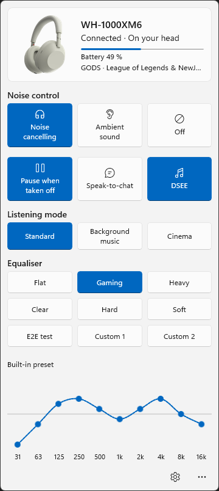
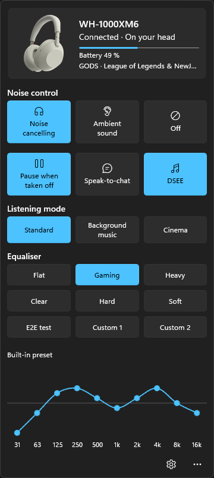
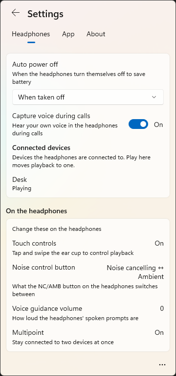
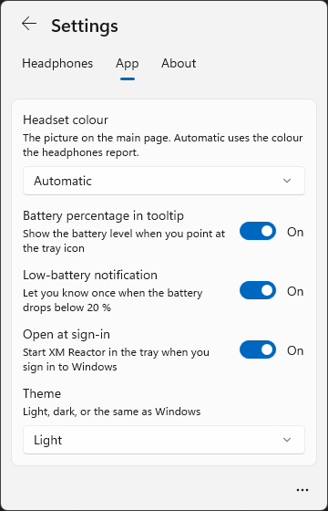

# XM Reactor

A Windows 11 tray app for Sony WH-1000XM6 headphones. It opens as a flyout above the system tray, shows the headphones at a glance, and puts the common changes one tap away. No account, no cloud, nothing leaves the PC.

  
  

## What it does

- **Noise control**: noise cancelling, ambient sound (with level and focus on voice), or off.
- **Everyday toggles**: pause when taken off (with resume when put back on), speak-to-chat, DSEE.
- **Listening mode**: standard, background music with a choice of room, or cinema.
- **Equaliser**: the headphones' presets, custom presets you can rename, and a curve you can drag or move with the keyboard.
- **The card**: your headphones in their real colour, battery with a low-battery notification, and what is playing.
- **Settings**: auto power off, capture your voice during calls, connected devices with a switch of playback, and app preferences such as the theme and opening at sign-in.
- **Honest controls**: when the headphones refuse something, for instance the equaliser during a call, the app says why instead of greying it out silently.

The look is Windows 11's own: stock WinUI 3 controls on Mica, the accent colour from Windows, light or dark with the system or by choice.

  
  

## Install

Get `XM-Reactor-Setup-<version>.msi` or `XM-Reactor-<version>-portable.zip` from the [Releases](https://github.com/CKJonesy/XM-Reactor/releases) page. The portable zip holds only `XMReactor.exe` and the licence notices; run it from any folder. Neither is code-signed yet, so SmartScreen warns the first time: choose More info, then Run anyway.

The installer is a per-user MSI. It needs no administrator rights, installs to `%LOCALAPPDATA%\Programs\XM Reactor`, adds a Start menu shortcut, and offers a tick box to open XM Reactor when you sign in (the same setting as Open at sign-in on the app's Settings page; for a silent install, `msiexec /i XM-Reactor-Setup-<version>.msi /qn STARTWITHWINDOWS=0` leaves it off). Installing over an older version closes the running copy (Windows may ask first) and keeps your settings and your sign-in choice.

XM Reactor needs the Windows App Runtime 2.x. The installer does not check for it. If it is missing, the app says so at start-up, offers the download page, and exits; install the runtime and start XM Reactor again.

Uninstalling from Apps & features closes the app, removes the sign-in entry and notification registration it wrote, and asks whether to delete its settings and logs in `%LOCALAPPDATA%\XM Reactor`. A silent uninstall (`msiexec /x ... /qn`) keeps them.

## Using it

Pair the headphones in Windows Settings first. XM Reactor finds them over Bluetooth, connects, and sits in the tray; click the tray icon to open the flyout, press Esc to close it. The tray icon shows the current noise control, and its tooltip the battery. If another app holds the headphones' control channel (Sony's own app, for one), XM Reactor says so rather than fighting for it.

Version 1 targets the WH-1000XM6 (firmware 3.1.5 verified). **Other Sony models are work in progress.** Headphones that speak the same protocol should connect and show the features they announce, but nothing beyond the XM6 has been tried on real hardware. If you own a WH-1000XM5, XM4, WF-1000XM5 or another recent Sony model and want to help, open an issue with the model name and what you see; a log from `%LOCALAPPDATA%\XM Reactor\logs\app.log` is the most useful thing you can attach.

## Build from source

Rust stable on Windows 11 with the Windows App SDK runtime installed. Then:

    cargo build --release -p xm-reactor
    cargo test --workspace

The repository has three crates: `xm-core` (the wire protocol, session and model, no UI), `xm-reactor` (the WinUI 3 app, built on [windows-reactor](https://github.com/microsoft/windows-rs)), and `xm-tools` (build-time helpers). `installer/build.ps1` makes the MSI and the portable zip; `.github/workflows/windows-build.yml` does the same on GitHub Actions and attaches both to a Release when a `v*` tag is pushed.

## Privacy

XM Reactor talks to the headphones directly over Bluetooth from this PC. There is no account, no telemetry and no network use of any kind. Settings and logs live in `%LOCALAPPDATA%\XM Reactor`.

## Licence

MIT. See [LICENSE](LICENSE).
